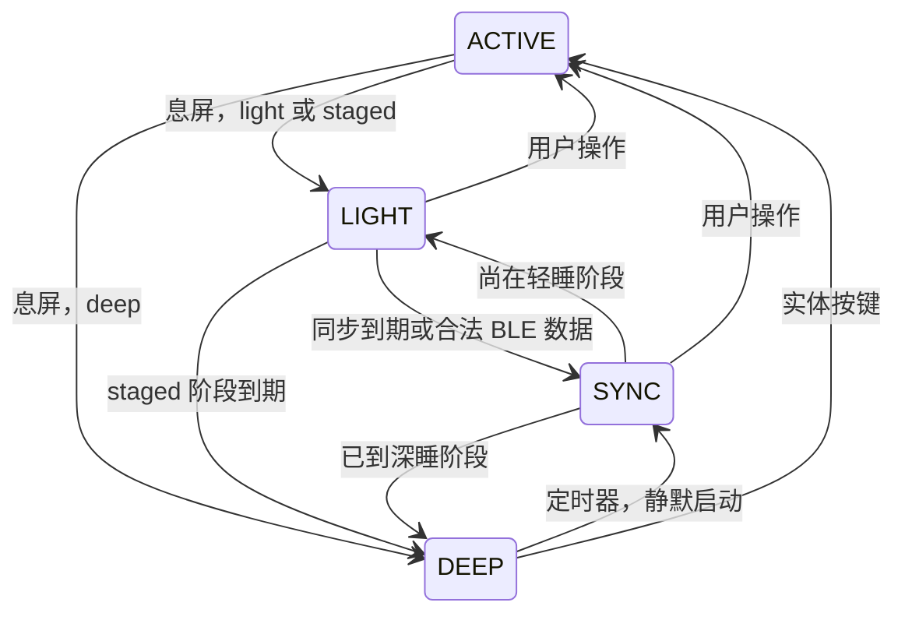

# 省电管理与分阶段休眠设计

当前开发版变更（2026-10-30）：息屏与整机休眠分离。电池默认息屏后保持 Wi-Fi/BLE 10分钟，之后轻睡10分钟（BLE接收保留、Wi-Fi按同步策略启停），再深睡；USB默认仅息屏。延时使用独立槽隔离sys_delay记录，旧电源模式与轻睡时长不变。设置“电源与休眠”可分别调整供电策略。倒计时仅用户操作重置；普通推送和实时日志不重置。主动文字/日志传输有总期限内的休眠保护，结束后继续原闲置阶段。以下历史设计中“息屏即轻睡”的表述由本段覆盖。实机行为仍待验收。

状态：0.3.0 源码实现与主机验证阶段；硬件验收未完成。2026-10-29。

实现入口和实际边界见 [Chrome 数据站使用说明](COMPANION.md)。下文保留目标合同，不能把设计中的所有硬件条件视为已通过。
仅适用于 ESP32-S3-Touch-AMOLED-2.16，沿用 ESP-IDF 5.5.5、BSP 2.0.1、LVGL 9.3.0 与现有依赖锁。本文不代表设备上已安装的 0.2.0 行为。通信设计见 [统一数据协议](DATA_PROTOCOL.md)。

## 目标与现状

电池供电优先续航，同时支持可配置的轻睡转深睡、定时静默同步，以及轻睡阶段的 BLE 数据接收。USB 默认只息屏、保持在线，可单独开启休眠策略。

2026-10-30 按键唤醒修正：实体键由独立系统任务每 16 ms 采样并做 32 ms 防抖，不随 LVGL 暂停；有效按下会锁存唤醒请求并立即通知电源任务，不再依赖一秒一次的瞬时电平检查。息屏时首次按键只唤醒，松手不再息屏或导航；中键继续按住两秒仍走原有有序关机与升级保护。深睡准备期间再次检查锁存请求，避免已识别的短按被休眠吞掉。上电或深睡重启时按键仍按住的，保持松手后才重新启用的规则。

该修正新增轻睡期间的 16 ms 按键轮询；没有实测其整板功耗或实体唤醒可靠率。USB/电池、仅息屏/轻睡/深睡的物理验收分别记录于 VALIDATION.md，不能由主机策略测试代替。

深睡准备成功卸载 TF 卡后，任何后续取消路径都会在释放 mutation 锁后恢复原来的挂载状态；原来未挂载的卡不主动挂载。按键路由、电源请求交接与 UI 先唤醒后读键使用同一可主机测试的实现，真实卡与实体按键行为仍需板级验收。

历史0.2.0检查中 sdkconfig 未启用 CONFIG_PM_ENABLE 和 CONFIG_BT_CTRL_MODEM_SLEEP，CPU 默认 240 MHz；ui.cpp 息屏只将亮度设为零，仍有 UI 刷新；core.cpp 服务循环有 50 ms 等待，board.cpp 周期采样存储状态。以上是源码检查，不是功耗实测。

| 优化点 | 如何优化 | 验证重点 |
|---|---|---|
| CPU | 启用 DFS、Tickless Idle、自动 Light-sleep；初始频率范围 80～240 MHz，关键工作按需持有 PM 锁 | 锁释放、驱动时序、交互延迟 |
| 显示 | 等待 flush 完成，暂停 LVGL 工作与 tick，执行面板关显示/休眠；恢复后重绘 | 不闪屏、不丢触摸、不在 GUI 锁内等待 I/O |
| BLE | Modem-sleep 配合自动 Light-sleep；活动与空闲使用不同连接参数 | 实际协商值、重连、漏消息、待机电流 |
| Wi-Fi | 亮屏及仅息屏模式保持已开启的 Wi-Fi 可用；整机休眠期间按同步任务启停，任务完成释放；不改用户持久开关 | USB/电池切换和唤醒恢复重连，休眠时防止重试任务自行重启无线 |
| 后台任务 | 事件和最近截止时间驱动，暂停无用轮询 | UI/存储容量采样不阻止休眠 |
| 外设 | 关闭音频活动，协调触摸、显示、TF 操作 | 共享电源轨、GPIO 漏电与唤醒电平 |
| 缓存 | 合并 RAM 更新，深睡前只保存变化快照 | 不逐笔行情写 Flash，写失败可恢复 |
| 网关选优 | 有界候选窗口、RSSI 平滑与切换滞回 | 不持续扫描、不反复切换 |

省电配置以固定 IDF 的 examples/bluetooth/nimble/power_save/sdkconfig.40m.esp32s3 为研究基线，核对 MAIN_XTAL、MODEM_SLEEP、PHY MAC/BB 省电选项，不照搬其单核配置。板载 PCF85063 RTC 不证明 ESP32 接有 32 kHz 晶振，不直接使用外部晶振配置。保留当前两个 12 行内部 DMA 绘图缓冲。

## 模式、设置与状态机

电池/USB 各持有一套配置，设置通过系统异步接口保存。旧版本的息屏时间保持原值；新配置使用独立带 schema 的系统记录，按 apps_a/apps_b 隔离，沿用 OTA 复制与回退，不改变旧 Config 布局。

| 字段 | 电池默认 | USB 默认 | 约束 |
|---|---|---|---|
| mode | staged | screen_only | screen_only / light / deep / staged |
| light_stage_minutes | 10 | 10 | 1～1440，仅 staged 生效 |
| sync_interval_minutes | 15 | 15 | 0=关闭，或 1～1440 |
| light_ble_receive | true | true | 开/关；受硬件能力验收约束 |
| transport_policy | ble_first | ble_first | ble_first / ble_only / wifi_only |

普通数据不亮屏。通知按应用独立授权，默认不允许；允许时单次亮屏最多 10 秒，同一应用至少间隔 60 秒，用户操作后转正常交互。无线关闭设置优先于自动路由：禁止的链路不能被兜底策略重新开启。

screen_only 只关闭显示，不执行整机休眠；staged 从屏幕关闭开始计算轻睡阶段。后台同步、重连、普通推送、通知自动亮屏均不重置闲置计时。只有用户实际操作结束本次闲置周期。

亮屏与 screen_only 模式每轮明确恢复 Wi-Fi/BLE 运行许可，仍由无线服务遵守用户持久开关。电池供电不按数据请求队列或 BLE 优先路由关闭前台 Wi-Fi；无线按需启停仅适用于实际整机休眠的同步阶段。恢复运行许可不依赖显示此前是否已暂停，覆盖通知临时亮屏后用户接管及供电策略切换。

轻睡分为两种实现：

- 保留 BLE：控制器 Modem-sleep + 自动 Light-sleep，由无线驱动按连接事件唤醒 CPU。不能直接调用会关闭无线的普通手动 Light-sleep 流程。
- 不保留 BLE：停止无线，保留 RAM，使用定时器与实体输入唤醒。

深睡关闭无线且丢失普通 RAM；**深睡不能接收 BLE 消息或由 BLE 数据唤醒**。需要持续等待蓝牙的用户选择 light，接受更高待机功耗。未建立连接时仅可能通过保留广播的无线轻睡接受合法重连，不保证手机后台会发起连接。

中键是必验唤醒入口，左/右键分别验证。GPIO16 的当前高有效电源键输入不能未经测量直接套用低有效唤醒配置。外接触摸 CST9217 的 GPIO11 中断、供电和睡眠命令需单独验证；ESP32 内置触摸唤醒不等于触摸屏唤醒。触摸能力未通过前不对用户开放。

## 调度与静默同步

同步周期独立于休眠阶段：进入深睡不重置下次同步期限。使用单调计时计算运行期截止时间；深睡前保存带版本、校验的 RTC 保留记录，恢复剩余时间。墙钟校准不改变相对倒计时。保留记录无效时重新建立周期，缓存时间不可信时标记过期。

后台一轮最多 60 秒：BLE 获取网关至多 20 秒；必要时 Wi-Fi 连接和同步至多 35 秒；预留 5 秒收尾。所有阶段共享总截止时间，提前完成立即休眠，超时取消网络工作并丢弃迟到结果。既有可用网关可直接使用，无需每轮全量选优。

1. 定时醒来只初始化供电、时间、缓存、调度和需要的通信服务；屏幕保持关闭，不播放声音。
2. 合并到期资源，执行统一数据服务请求；息屏不维持秒级股票订阅。
3. BLE 不可用且策略允许时使用已保存 Wi-Fi；没有配置或被用户禁用则跳过。
4. 更新有限缓存，记录结果并关闭不再需要的无线，返回应处的休眠阶段。
5. 失败保留旧缓存和原因，下个周期再尝试；不无限重连，不补发累积的每一个遗漏周期。

没有后台资源时不为同步单独唤醒；仍保留分阶段转换与实体唤醒期限。设置变更以变更时刻重建同步期限。用户操作可提升静默同步为交互状态并复用请求。

## 休眠协调、存储与恢复

系统 PowerManager 是唯一状态仲裁者。应用用有限时长的阻止休眠租约报告必要工作，不直接关闭硬件；UI 订阅与系统后台计划分离。

进入休眠顺序：停止接入新任务、取消非必要请求、等待关键工作结束、保存必要快照、协调显示及外设、配置唤醒源、停止无线或进入无线省电、进入休眠。任何准备步骤失败则取消本次休眠，记录原因，禁止带着未完成 Flash 写入强行睡眠。

- OTA 传输、校验、PENDING_VERIFY 启动验收期间禁止整机休眠；保持现有 UI/服务健康检查，不全局关闭看门狗。
- 普通休眠期间健康监控显式识别受控暂停。恢复后重新建立心跳期限，不能把休眠时间判成死锁。
- 深睡恢复保存页面 ID 和必要业务状态，不保存 LVGL 指针；无效快照回桌面。
- 设置保存在槽隔离配置中；缓存是可丢弃数据，使用带 schema、长度与校验的快照。写入失败保留旧快照，启动时不自动格式化文件系统。
- 常规行情更新只写 RAM；深睡前最多保存一份有变化的有界快照。冷启动缓存不可验证时标记缺失，不能伪装新鲜。
- 不调用 PMU shutdown 代替深睡；保持充电、RTC 和唤醒电路。电源轨映射未核实前只用已验证的驱动级节电，不随意关闭 AXP2101 输出。
- USB 插入/拔出切换策略时不改变用户保存配置；深睡中检测 USB 事件需要实际唤醒连线支持，未验收时最迟在下一次定时/按键唤醒后应用策略。

## 实施顺序与验收

顺序：电流基线 → 单网关统一协议 → CPU/显示/BLE 轻睡 → 深睡及静默启动 → 多网关 → 完整回归。

必验场景：

- 轻睡 10 分钟转深睡，持续后台推送不延后；修改阶段时间、周期及关闭同步均按定义生效。
- 默认 15 分钟同步、定时失败、无网关/网络、错误凭据都在预算内结束；用户操作可中途接管。
- BLE 轻睡收消息不亮屏；深睡不误宣称 BLE 可达；实体键首次仅唤醒，长按关机行为保持。
- 触摸唤醒、面板无闪亮、USB 事件分别作为实机项目，不能由截图代替。
- 反复睡醒无内存增长、无看门狗误报；OTA 与新槽验收不被休眠打断；配置回退正确。
- 实际电池供电测亮屏、BLE 轻睡、无线关闭轻睡、深睡及单次同步能量；使用足够采样率捕获射频峰值，记录电压、亮度、信号、周期、固件指纹和测量位置。
- 同条件至少覆盖多个完整同步周期，报告平均功率、周期能量和分布；续航按有效电池能量/平均功率估算，芯片微安数不代表整板耗电。

测试结果后续按构建追加到 VALIDATION.md，区分编译、协议、实机、用户物理观察。本文不填写任何“通过”，不将运行中的长测视为完成。

## 依据

- [ESP-IDF 5.5.5 Sleep Modes](https://docs.espressif.com/projects/esp-idf/en/v5.5.5/esp32s3/api-reference/system/sleep_modes.html)
- [ESP-IDF 5.5.5 Power Management](https://docs.espressif.com/projects/esp-idf/en/v5.5.5/esp32s3/api-reference/system/power_management.html)
- 固定 SDK 的 examples/bluetooth/nimble/power_save，以及当前 esp_lvgl_adapter 的 pause/resume 接口。后者暂停时停止 LVGL tick，但仍需系统协调其他任务。
